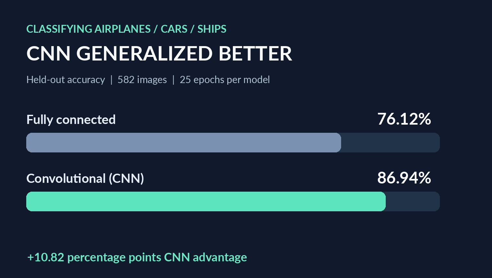
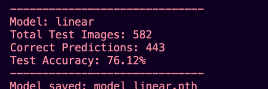
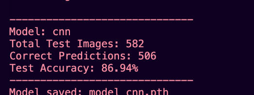

# Neural Networks vs. CNNs: Image Classification with PyTorch



A hands-on deep learning study built as part of graduate coursework in computer science at the University of Bridgeport. I trained two architectures to classify **airplanes, cars, and ships**, then compared their ability to generalize to held-out images. The project also explores how hidden-layer size and nonlinear activations affect decision boundaries on a two-moons dataset.

## Key results

| Model | Train accuracy (final epoch) | Test accuracy | Correct / tested |
| --- | ---: | ---: | ---: |
| Fully connected network | 100.00% | **76.12%** | 443 / 582 |
| Convolutional neural network | 100.00% | **86.94%** | 506 / 582 |

**The CNN performed 10.82 percentage points better on the held-out test set.** Both networks attained 100% training accuracy, but test performance was lower: training fit alone was not a reliable measure of generalization. These are individual experimental runs; they are not averaged across random seeds.

### Experimental setup

- **Dataset:** 3,000 training images available and 582 test images, in three categories: airplanes (0), cars (1), ships (2).
- **Preprocessing:** RGB, resize to 224 × 224, conversion to tensors, normalize channels to [-1, 1].
- **Training:** 25 epochs, minibatch 16, stochastic gradient descent (learning rate 0.001, momentum 0.9).
- **Architectures:** two-layer fully connected classifier (150,528 inputs → 100 hidden neurons → 3 classes) versus two-convolution/two-pooling CNN with a 100-unit classifier head.
- **Device:** Apple Silicon GPU via PyTorch MPS (with CPU fallback).
- **Reproducibility note:** training loader uses `drop_last=True`, so 2,992 of the 3,000 available training images are used in a given epoch; shuffling changes which eight are dropped. Code retains the assignment's final Softmax layers and computes NLL on log-probabilities.

## Visual evidence from experiment runs

| Fully connected model | CNN |
| --- | --- |
|  |  |

## Decision boundaries: the role of nonlinearity

The smaller two-moons study explored **1, 3, 5, and 30 hidden neurons**, as well as 5 and 30 hidden neurons with all activation functions removed.

| Hidden neurons | With ReLU | No activation |
| ---: | ---: | ---: |
| 1 | 85.50% | — |
| 3 | 88.50% | — |
| 5 | 88.00% | 87.50% |
| 30 | 95.00% | 85.50% |

**Takeaway:** Without nonlinear activations, the composition of affine layers is still affine. More hidden units cannot make the two-class decision boundary curved. Accuracy values above are from different random dataset generations and model initializations, so they should not be treated as controlled comparisons. Decision-boundary figure screenshots from those runs are not archived here.

## Run locally

Tested during the original experiment with Python 3.14 on an Apple Silicon Mac. Dependencies may change across PyTorch releases.

```bash
python3 -m venv .venv
source .venv/bin/activate  # macOS / Linux
pip install -r requirements.txt
```

Download the **Cars Planes Ships** course dataset only if you have permission to access it. Extract it in the following structure (the dataset is intentionally **not redistributed** here):

```text
data/
└── Dataset_PlanesCarsShips/
    ├── train/
    │   ├── airplanes/
    │   ├── cars/
    │   └── ships/
    └── test/
        ├── airplanes/
        ├── cars/
        └── ships/
```

Train each classifier:

```bash
python SimpleClassification.py --model linear --epochs 25
python SimpleClassification.py --model cnn --epochs 25
```

Run the decision-boundary experiments:

```bash
# Edit hidden_size in ClassificationNN.py to 1 / 3 / 5 / 30.
python ClassificationNN.py
python ClassificationNN_NoActivation.py --hidden 5
python ClassificationNN_NoActivation.py --hidden 30
```

Explore the tensor fundamentals:

```bash
python PytorchFundamentals.py
```

## Project structure

- `ACSDataSet.py`, `UtilsACS.py`: dataset and image data loaders.
- `NetworkLinear.py`, `NetworkCNN.py`: model architectures.
- `SimpleClassification.py`: training, test evaluation, and model saving.
- `MyDataSet.py`, `Utils.py`, `Network.py`, `ClassificationNN.py`: two-moons classification.
- `NetworkNoActivation.py`, `ClassificationNN_NoActivation.py`: no-activation variant.
- `PytorchFundamentals.py`: tensor API exercises.
- `results/experiment_results.csv`: results recorded from original runs.
- `assets/`: chart and cropped terminal screenshots from those runs.

## Limitations and context

This is an educational comparison, not a production classifier. There is no fixed random seed, independent validation split, hyperparameter search, or multi-run uncertainty estimate. The very high training accuracy alongside lower test accuracy is consistent with overfitting. For stronger experiments, use fixed train/test splits and random seeds, measure class-level metrics, and track learning curves on a validation set.

**Source note:** Some source files were recreated from the documented experiment in an earlier conversation. Before representing the repository as the exact original submission, compare them against the local files actually run on the Mac. This portfolio version omits the assignment handout, student-identifying submission report, trained weights, and image dataset.
